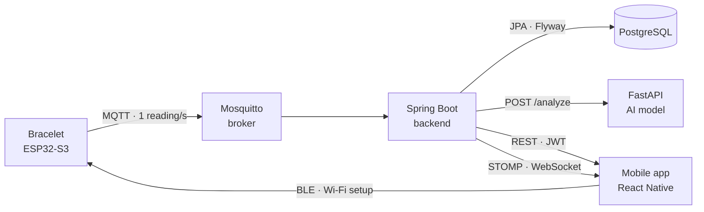
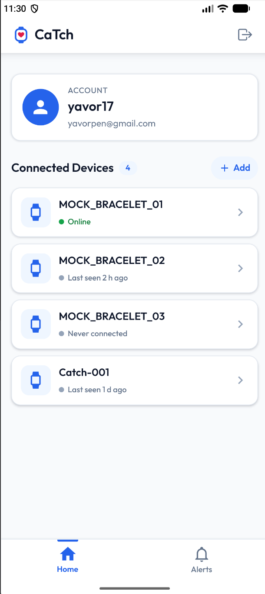

# CaTch

[](https://spring.io/projects/spring-boot)
[](https://reactnative.dev/)
[](https://fastapi.tiangolo.com/)
[](https://www.postgresql.org/)
[](https://opensource.org/licenses/MIT)

> CaTch is a smart bracelet for older people who live alone. It monitors heart rate, blood oxygen and movement around the clock, detects falls with an AI model and lets the family follow everything live from a mobile app.

## Problem Statement

One in three people over 65 falls every year, and falls are a leading cause of accidental injury deaths worldwide (WHO). For someone who lives alone, the fall itself is often not the worst part:

- **No one sees it.** Nobody is there when it happens.
- **Help comes late.** Hours on the floor make injuries much worse.
- **The family is in the dark.** Relatives only know how things are when they call.
- **SOS buttons need a press.** After a fall, many people cannot press one.

CaTch removes the need to ask for help. The bracelet sends a reading every second, the server analyses the motion and the family sees a possible fall in the app straight away, without the wearer doing anything. See [System Architecture](#system-architecture).

## Key Features

**Core**

- **Automatic fall detection.** A PyTorch model analyses 75 motion samples (acceleration and rotation) and returns the activity and a fall probability. A detected fall shows a red alert and a red posture figure in the app.
- **Live vitals.** Heart rate and SpO₂ are updated every second and pushed to the app in real time over WebSocket (STOMP).
- **Activity and posture.** The model recognises walking, standing still, lying down, stairs and transitions, and the app shows them as an animated figure.
- **Online status.** You see whether the bracelet is connected and when it was last seen.

**Monitoring**

- **Trends and statistics.** Heart rate and SpO₂ charts for live, 10 min, 30 min and 1 h windows, with min, average and max values.
- **Step counter.** The bracelet counts steps on-device from the accelerometer and shows them on its display.

> [!NOTE]
> The server keeps the last 120 raw readings per bracelet (about 2 minutes). Longer history is stored as 10-second statistics buckets for 60 minutes, so trends stay fast and the database stays small.

**Setup and accounts**

- **Bluetooth onboarding.** The app sends the Wi-Fi details to the bracelet over BLE, and the bracelet is then securely paired with the user's account.
- **Secure accounts.** Registration with email verification, JWT access tokens with rotating refresh tokens, and password reset by email.
- **Family sharing.** The owner invites relatives by username. Once they accept, relatives get read access to the owner's bracelets.

> [!IMPORTANT]
> The ESP32-S3 supports 2.4 GHz Wi-Fi only. During setup, choose a 2.4 GHz network; the bracelet cannot connect to a 5 GHz-only network.

## System Architecture



> [!NOTE]
> Fall detection runs on the server, not on the bracelet. Spring Boot sends the latest 75 readings to the AI service, saves the result and pushes it to every subscribed app. If the WebSocket connection drops, the app falls back to polling the REST API until it reconnects.

## Application Preview

<table>
  <tr>
    <td align="center">
      <br>
      <sub>Account and connected bracelets with online status</sub>
    </td>
    <td align="center">
      <br>
      <sub>Live vitals, walking posture and heart rate trend</sub>
    </td>
  </tr>
</table>

## Documentation

| Document | Description |
|---|---|
| [REST API endpoints](docs/api/endpoints.md) | Endpoints, request and response formats of the Spring Boot API |
| [AI service endpoints](docs/api/fastApiEndpoints.md) | The `/analyze` endpoint of the fall-detection service |
| [Project presentation](docs/presentation/catch.html) | Problem, solution, architecture and hardware overview |

## Technology Stack

### Software

| Component | Technology | Version |
|---|---|---|
| Mobile app | React Native | 0.86 |
| | Expo | SDK 57 |
| Backend | Spring Boot | 4.1.1 |
| | Java | 25 |
| Database | PostgreSQL | 17 |
| Message broker | Eclipse Mosquitto (MQTT) | 2.x |
| AI service | FastAPI | 0.163 |

### Hardware

| Component | Model | Role |
|---|---|---|
| Microcontroller | ESP32-S3 DevKitC-1 | Main control unit, Wi-Fi and BLE |
| Heart sensor | MAX30102 | Heart rate and SpO₂ |
| Motion sensor | MPU6050 | Accelerometer and gyroscope for falls, posture and steps |
| Display | SSD1306 OLED 128×64 | Vitals, steps and connection status |
| Buzzer | Piezo buzzer | Sound feedback for pairing and status |
| Buttons | 2 × push button | Menu navigation and factory reset |

## Build

The backend is packaged as a Docker image. A multi-stage build compiles the jar with Gradle and runs it on a slim JRE image. It works on any system with Docker:

| OS | Requirement |
|---|---|
| Windows 10 / 11 | Docker Desktop with the WSL 2 backend |
| macOS (Intel and Apple Silicon) | Docker Desktop |
| Linux | Docker Engine |

Create `server/.env` with the variables listed in [`server/env_template.txt`](server/env_template.txt), then build and start the container:

```bash
cd server
docker build -t catch-server .
docker run -d --name catch-backend -p 7070:7070 --env-file .env --restart unless-stopped catch-server

```

View the logs with `docker logs -f catch-server` and stop the container with `docker stop catch-server`.

> [!NOTE]
> PostgreSQL, the MQTT broker and the AI service are not part of the image and must already be running. Inside the container `localhost` means the container itself, so point `SPRING_DATASOURCE_URL`, `MQTT_BROKER_URL` and `AI_BASE_URL` to `host.docker.internal` when these services run on the host. On Linux, also add `--add-host=host.docker.internal:host-gateway` to `docker run`. `SPRING_PORT` must be `7070` to match the published port.

## License

This project is licensed under the **MIT License**. See [LICENSE](LICENSE) for details.
