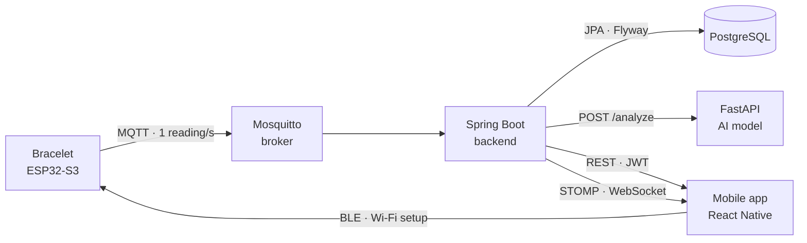
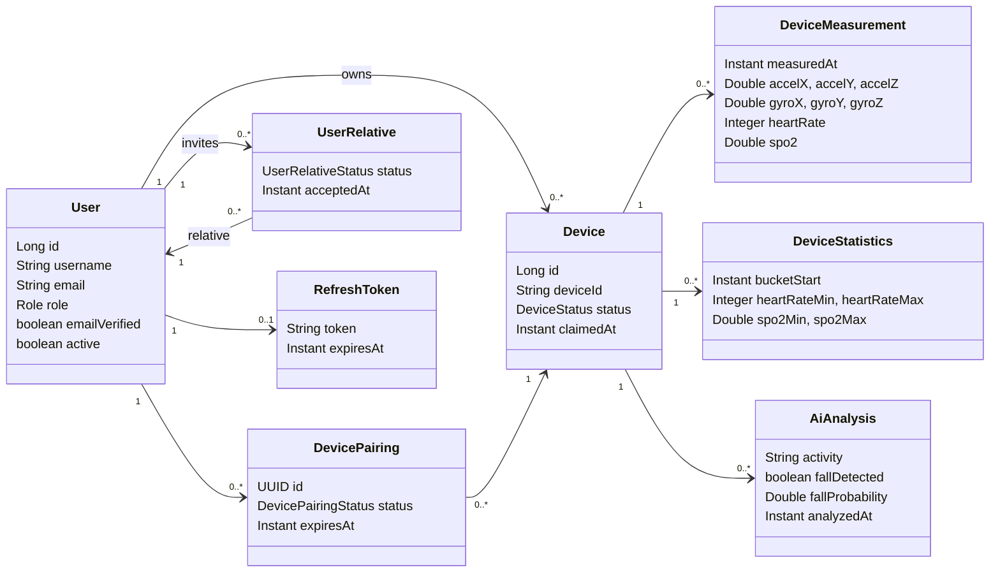
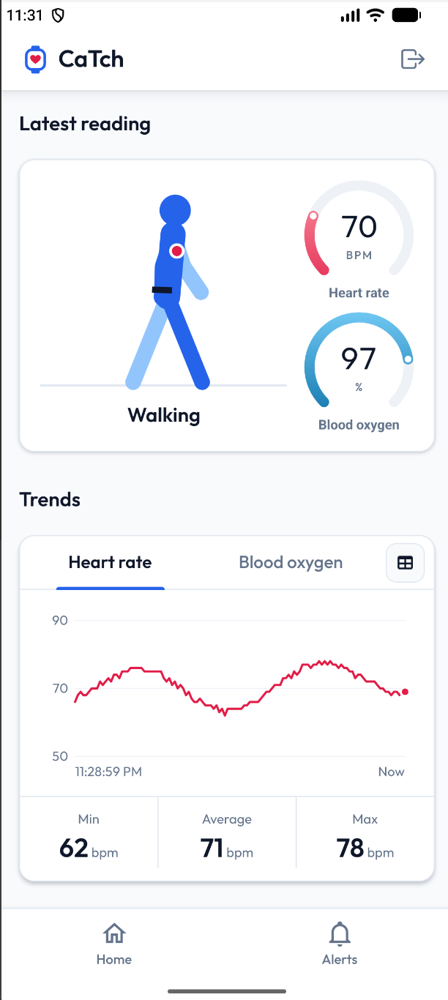

# CaTch

CaTch is a smart bracelet for older people who live alone. It monitors heart rate, blood oxygen and movement around the clock, detects falls with an AI model and lets the family follow everything live from a mobile app.

## The problem

One in three people over 65 falls every year, and falls are a leading cause of accidental injury deaths worldwide (WHO). For someone who lives alone, the fall itself is often not the worst part:

- **No one sees it.** Nobody is there when it happens.
- **Help comes late.** Hours on the floor make injuries much worse.
- **The family is in the dark.** Relatives only know how things are when they call.
- **SOS buttons need a press.** After a fall, many people cannot press one.

CaTch removes the need to ask for help. The bracelet sends a reading every second, the server analyses the motion and the family sees a possible fall in the app straight away, without the wearer doing anything. See [how it works](#architecture).

## Features

**Core**

- **Automatic fall detection.** A PyTorch model analyses 75 motion samples (acceleration and rotation) and returns the activity and a fall probability. A detected fall shows a red alert and a red posture figure in the app.
- **Live vitals.** Heart rate and SpO₂ are updated every second and pushed to the app in real time over WebSocket (STOMP), so the app does not poll.
- **Activity and posture.** The model recognises walking, standing still, lying down, stairs and transitions, and the app shows them as an animated figure.
- **Online status.** You see whether the bracelet is connected and when it was last seen.

**Monitoring**

- **Trends and statistics.** Heart rate and SpO₂ charts for live, 10 min, 30 min and 1 h windows, with min, average and max values. Readings are grouped into 10-second buckets on the server.
- **Step counter.** The bracelet counts steps on-device from the accelerometer and shows them on its display.

**Setup and accounts**

- **Bluetooth onboarding.** The app sends the Wi-Fi details to the bracelet over BLE, and the bracelet is then securely paired with the user's account.
- **Secure accounts.** Registration with email verification, JWT access tokens with rotating refresh tokens, and password reset by email.
- **Family sharing.** The owner invites relatives by username. Once they accept, relatives get read access to the owner's bracelets.

> [!IMPORTANT]
> CaTch is a student project and not a certified medical device. It is meant to support, not replace, professional care and emergency services.

## Architecture

Detailed references:

- [REST API endpoints](docs/api/endpoints.md)
- [AI service endpoints](docs/api/fastApiEndpoints.md)
- [Project presentation](docs/presentation/catch.html)

### Domain model

## Screenshots

<table>
  <tr>
    <td align="center">
       
      Account and connected bracelets with online status
    </td>
    <td align="center">
       
      Live vitals, walking posture and heart rate trend
    </td>
  </tr>
</table>

## Tech stack

<table>
<tr>
<td valign="top">

| Component | Technology | Version |
|---|---|---|
| Mobile app | React Native | 0.86 |
| | Expo | SDK 57 |
| Backend | Spring Boot | 4.1.1 |
| | Java | 25 |
| Database | PostgreSQL | 17 |
| Message broker | Eclipse Mosquitto (MQTT) | 2.x |
| AI service | FastAPI | 0.163 |
| | PyTorch | 2.x |
| Firmware | PlatformIO (Arduino) | latest |

</td>
<td valign="top">

| Component | Model | Role |
|---|---|---|
| Microcontroller | ESP32-S3 DevKitC-1 | Main control unit, Wi-Fi and BLE |
| Heart sensor | MAX30102 | Heart rate and SpO₂ |
| Motion sensor | MPU6050 | Accelerometer and gyroscope for falls, posture and steps |
| Display | SSD1306 OLED 128×64 | Vitals, steps and connection status |
| Buzzer | Piezo buzzer | Sound feedback for pairing and status |
| Buttons | 2 × push button | Menu navigation and factory reset |

</td>
</tr>
</table>

> [!NOTE]
> In the current firmware build the heart rate and SpO₂ values are simulated. Integration of the MAX30102 driver is in progress. Motion data from the MPU6050 is real.

## License

This project is licensed under the **MIT License**. See [LICENSE](LICENSE) for details.
